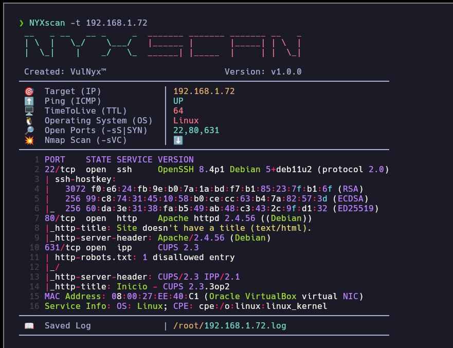

# **NYXscan**

#### **NYXscan** is a fast and in-depth port scanner that makes initial enumeration of a target easy.  
It performs basic host checks, os detection, and a two-stage port scanning process to deliver comprehensive results.



---

## **Features**

1. **Ping Test**:  
   - Verifies if the target (IP/Domain) is alive.
   - Determines the operating system based on the Time-to-Live (TTL) value:
     - **`63`/`64`**: Identified as `Linux`.  
     - **`127`/`128`**: Identified as `Windows`.

2. **Quick Port Scan [(Nmap)](https://nmap.org)**:  
   - Detects open ports on the target using a fast scanning method.

3. **Deep Scan [(Nmap)](https://nmap.org)**:  
   - Performs an in-depth analysis of services running on the previously detected open ports.

4. **Colorized Output [(Bat)](https://github.com/sharkdp/bat)**: 
   - Scan result with syntax highlighting for better visualization.

---

## Download

```sh
wget --no-check-certificate -q "https://raw.githubusercontent.com/VulNyx/Arsenal/refs/heads/main/NYXscan/NYXscan" && chmod +x NYXscan
```

## Download & Install (PATH)

```sh
wget --no-check-certificate -q "https://raw.githubusercontent.com/VulNyx/Arsenal/refs/heads/main/NYXscan/NYXscan" -O /usr/bin/NYXscan && chmod +x /usr/bin/NYXscan
```

## Usage

Install `nmap`, `bat` (available as either `bat` or `batcat`), and `ping`
before running NYXscan. On Debian or Ubuntu, for example:

```sh
sudo apt install nmap bat iputils-ping
```

NYXscan reports missing Nmap or Bat dependencies and does not install them.
Its SYN scan (`nmap -sS`) requires the necessary raw-socket privileges.

```sh
NYXscan -t 192.168.1.X
NYXscan -t domain.nyx
```

## Test

From the repository root, run `python3 NYXscan/test_nyxscan.py`. The tests use
simulated Nmap and Bat commands and do not scan a network.

---
