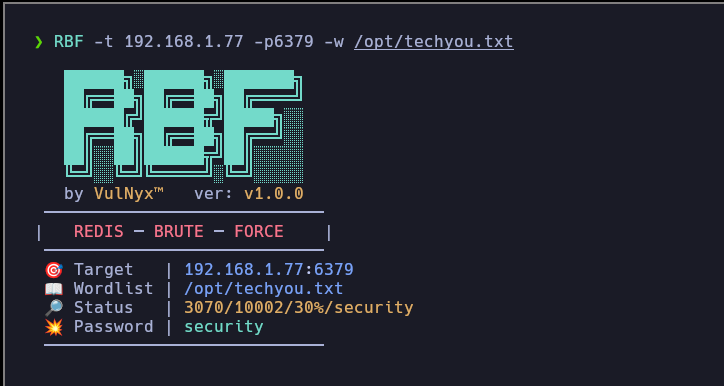

# **RBF**

#### Get `Redis` password by brute force attack.



---

## Download

```sh
wget --no-check-certificate -q "https://raw.githubusercontent.com/VulNyx/Arsenal/refs/heads/main/RBF/RBF" && chmod +x RBF
```

## Download & Install (PATH)

```cmd
wget --no-check-certificate -q "https://raw.githubusercontent.com/VulNyx/Arsenal/refs/heads/main/RBF/RBF" -O /usr/bin/RBF && chmod +x /usr/bin/RBF
```

## Usage

Install `redis-cli` before running RBF. On Debian or Ubuntu it is provided by
the `redis-tools` package. RBF reports a missing dependency without installing it.

```sh
RBF -t <TARGET> -p <PORT> -w <WORDLIST>
```

To check missing-dependency handling, run `python3 RBF/test_dependency.py` from
the repository root.

---
