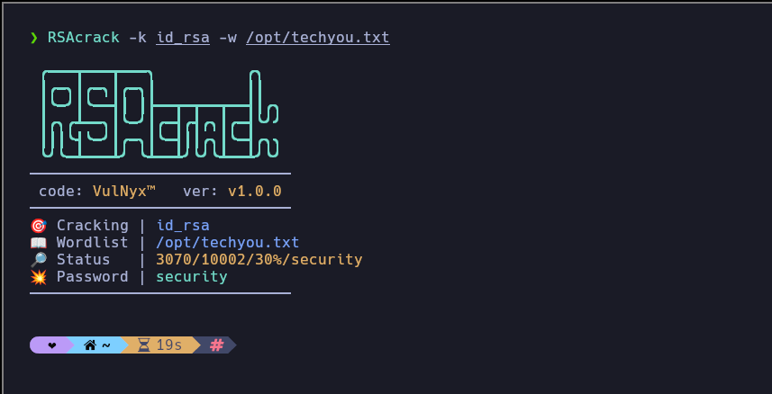

# **RSAcrack**

### Overview

If you have a **private key (id_rsa)** protected by a **passphrase** and you want to obtain the **password**, `RSAcrack` will attempt to obtain the **public key** with the [ssh-keygen](https://manpages.ubuntu.com/manpages/noble/man1/ssh-keygen.1.html) binary, performing a **brute force** attack until a successful collision occurs.



### Download

```sh
wget --no-check-certificate -q "https://raw.githubusercontent.com/VulNyx/Arsenal/refs/heads/main/RSAcrack/RSAcrack" && chmod +x RSAcrack
```

### Download & Install (PATH)

```cmd
wget --no-check-certificate -q "https://raw.githubusercontent.com/VulNyx/Arsenal/refs/heads/main/RSAcrack/RSAcrack" -O /usr/bin/RSAcrack && chmod +x /usr/bin/RSAcrack
```

### Usage

```sh
RSAcrack -k <KEY> -w <WORDLIST>
```

Quote paths containing spaces, for example `RSAcrack -k "my key" -w "my wordlist"`.
Wordlist entries may contain spaces, and the last entry does not need a trailing
newline. RSAcrack sets the private key's permissions to `600` before testing it.

### Test

From the repository root, run `bash RSAcrack/test-rsacrack.sh`. The tests use
`ssh-keygen` to create temporary keys and do not contact any remote system.

> [!WARNING]
> The cracking speed can vary depending on which tool the key is generated with.

| Key Generated | Cracking Speed     |
|---------------|--------------------|
| OpenSSL       | :heavy_check_mark: |
| ssh-keygen    | :x:                |
| PuTTYgen      | :heavy_check_mark: |
| 8gwifi        | :heavy_check_mark: |
