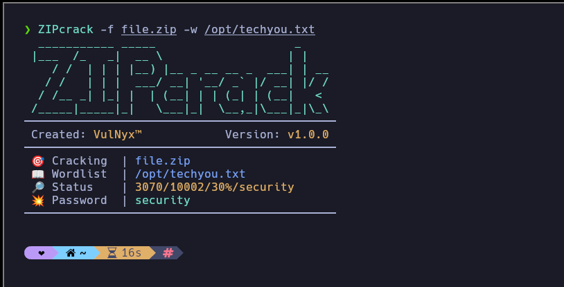

# **ZIPcrack**

#### Get the password of a compressed `ZIP` file.



---

## Download

```sh
wget --no-check-certificate -q "https://raw.githubusercontent.com/VulNyx/Arsenal/refs/heads/main/ZIPcrack/ZIPcrack" && chmod +x ZIPcrack
```

## Download & Install (PATH)

```cmd
wget --no-check-certificate -q "https://raw.githubusercontent.com/VulNyx/Arsenal/refs/heads/main/ZIPcrack/ZIPcrack" -O /usr/bin/ZIPcrack && chmod +x /usr/bin/ZIPcrack
```

## Usage

```sh
ZIPcrack -f <FILE> -w <WORDLIST>
```

ZIPcrack requires `7z` from 7-Zip. Quote archive and wordlist paths that
contain spaces. Passwords can contain spaces, and the final wordlist entry
does not need a trailing newline.

## Test

From the repository root, run `bash ZIPcrack/test-zipcrack.sh` with `7z` on
your `PATH`. The test creates temporary encrypted ZIP archives.

---
